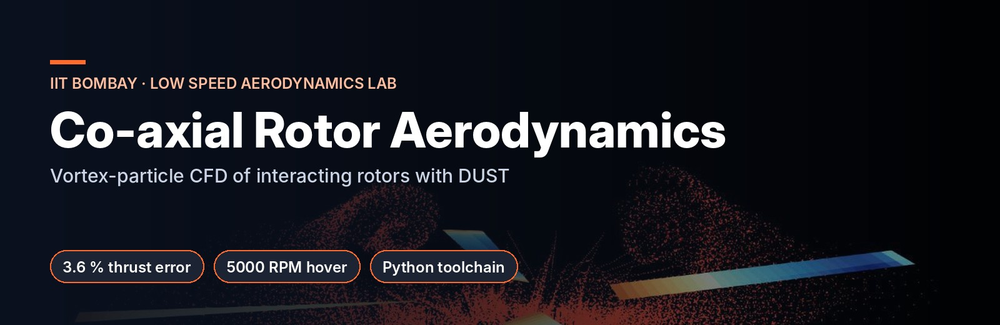
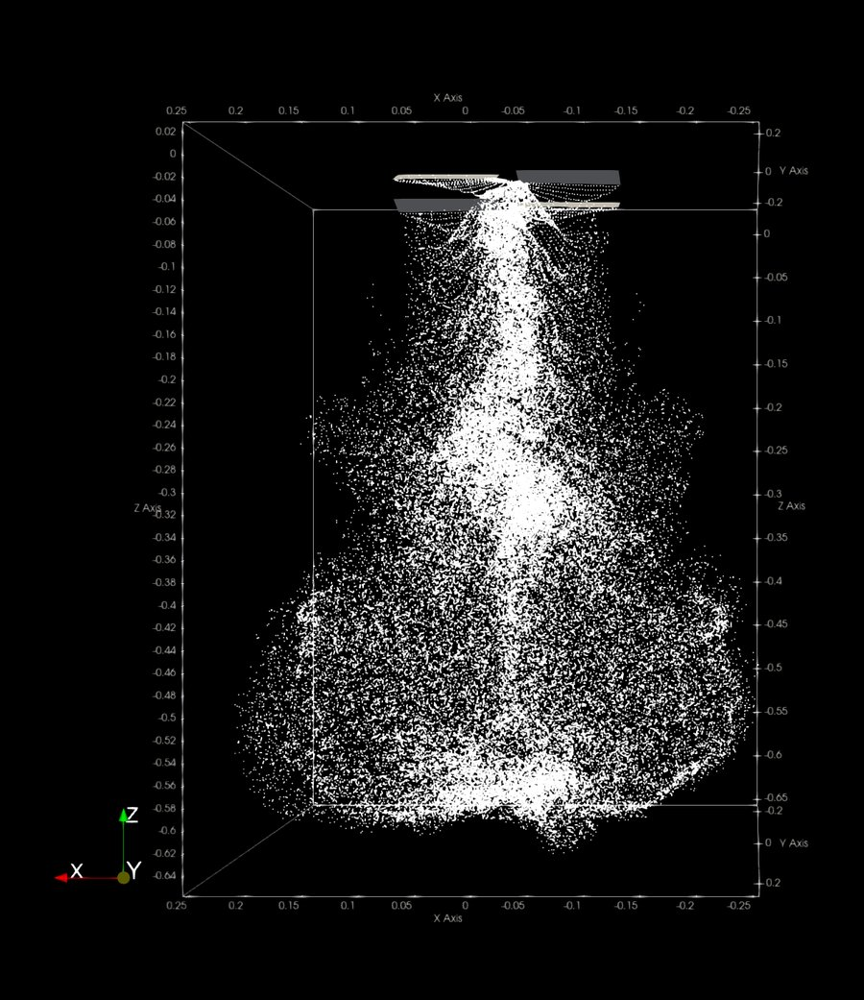
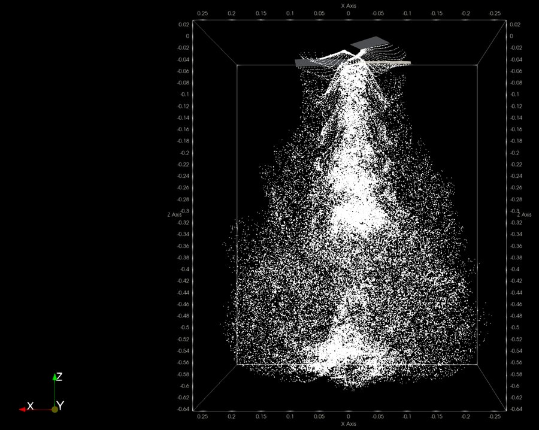
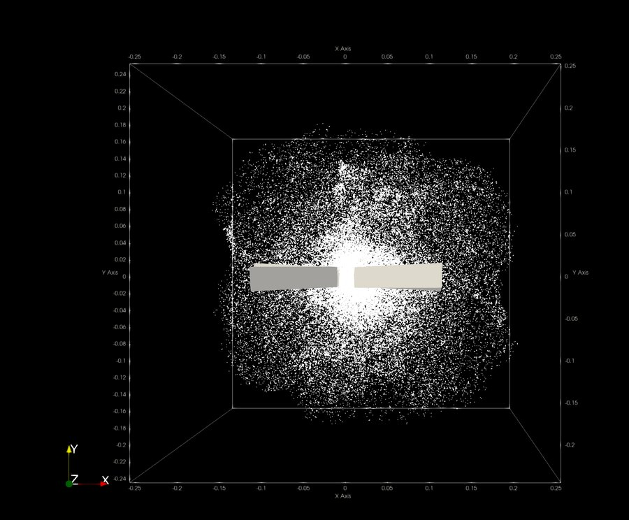
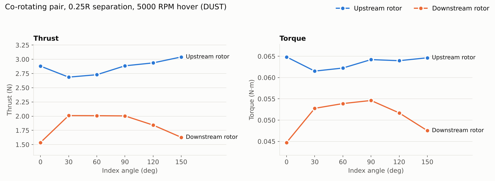
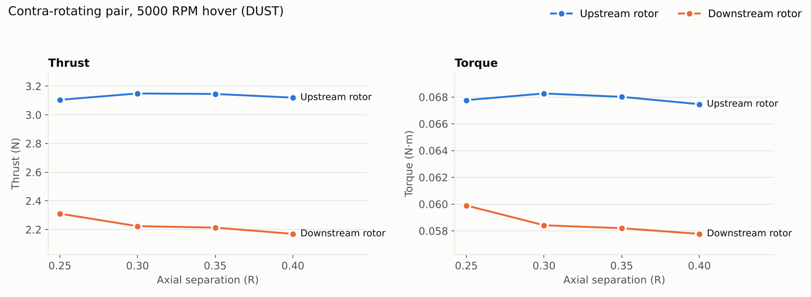
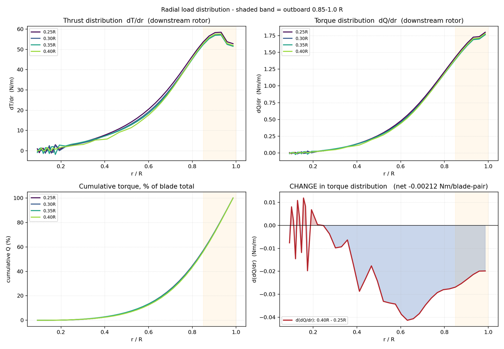
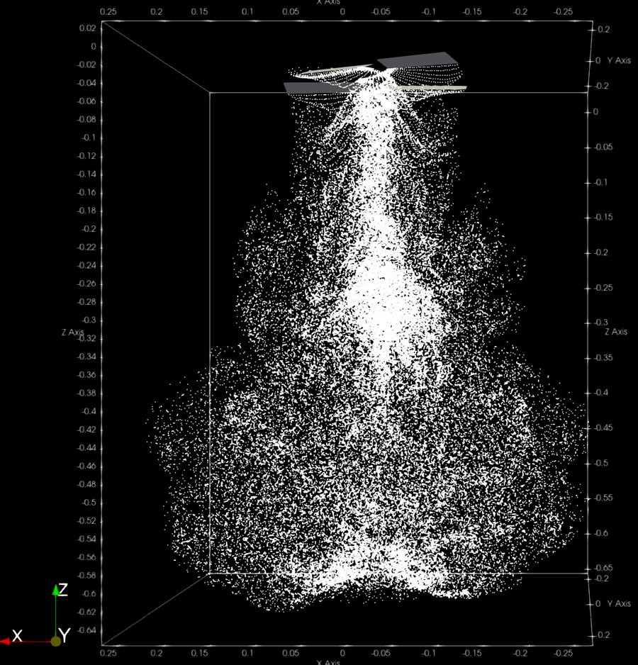
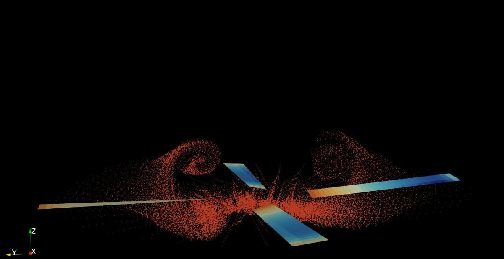

# Co-axial Rotor Aerodynamics with DUST (Vortex-Particle Method)

**Low Speed Aerodynamics Lab, Dept. of Aerospace Engineering, IIT Bombay** · Research Intern under Prof. Dhwanil Shukla · Jun – Aug 2025

I simulated co-rotating and contra-rotating co-axial rotor pairs in hover with **[DUST](https://gitlab.com/dust_group/dust)**, a mid-fidelity Lagrangian vortex-particle solver (Politecnico di Milano / Airbus), to understand rotor-to-rotor interference.

  

Vortex-particle wakes in ParaView: co-rotating pair after 11 revolutions (left), contra-rotating pair (centre), top view (right)

## Setup

| | |
|---|---|
| Rotors | 9-inch, 2-bladed, blended NACA 23024 root → NACA 23012 tip |
| Condition | Hover, 5000 RPM |
| Axial separation | 0.25R – 0.40R |
| Index (phase) angle | 0° – 150° in 30° steps (co-rotating pair at 0.25R) |
| Toolchain | DUST on Linux (WSL), Python post-processing, ParaView |

## Key results

- When correlated against the lab's measurements, the **upstream rotor came within 3.6 % on thrust and 6 % on torque**. A Fluent RANS dataset on the same case returned 8.0 % and 16.2 %, at far higher computational cost.
- **Rotor-to-rotor interference:** the co-rotating lower rotor loses **34–51 % of its thrust** compared with an isolated rotor, and varies by **27 % with index angle alone**. A single-rotor model sees none of this.
- Early runs were well off. I traced the problem to three setup errors: the **rotor origin definition**, the **reference-frame assignment** and the **freestream velocity orientation**. I then rebuilt the whole case matrix.

The upstream rotor barely notices the index angle. The downstream rotor, sitting in the upper rotor's wake, swings by about 0.5 N of thrust as the blades move in and out of phase.

### Where along the blade the load changes

Torque is Q = ∫(Fx·r + Fy·c/4) dr, so it is weighted by radius. A change in total torque says nothing about its cause, so `radial_diag.py` shows where along the span it comes from:

 

Index-angle case at 0.25R (left); single-rotor baseline wake coloured by vorticity (right)

## Code

| File | What it does |
|---|---|
| [`postprocessing/dust_postpro.py`](postprocessing/dust_postpro.py) | Parses DUST sectional-load `.dat` files and **integrates per-blade thrust, torque, Mx and My with the trapezoidal rule**, averaged over the final revolution. Writes per-blade and per-rotor CSVs. |
| [`postprocessing/radial_diag.py`](postprocessing/radial_diag.py) | Plots radial thrust and torque distributions between cases and shows where the change comes from. |

## Results

[`results/`](results) has the integrated simulation loads, per blade and per rotor, for every case.

> The case input decks and the lab's experimental data are not published.

---
*Akshay Malhan · B.E. Mechanical Engineering, Thapar Institute · [LinkedIn](https://linkedin.com/in/akshaymalhan)*
